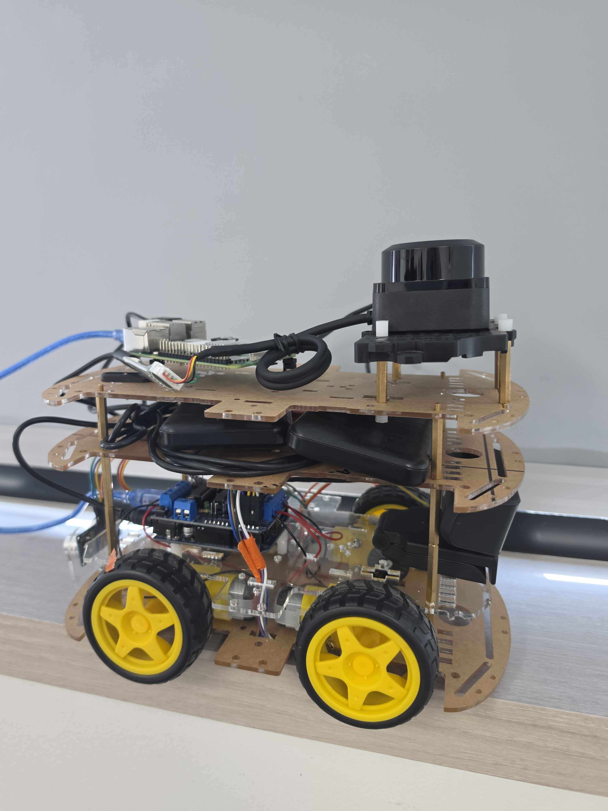

# AI & Robotics Software Developer

안녕하세요! 로봇 소프트웨어와 인공지능 기술을 공부하고 있는 개발자 정윤상입니다.

## 기술 스택
- Languages: Python, C/C++
- Robotics: ROS 2, Gazebo, RViz, TF2
- AI: PyTorch, Transformers, VLA/VLM
- Tools: Git, GitHub, Docker, Ubuntu

### Tech Stack Icons


## 주요 프로젝트

### 1. ARION - AI 기반 드론 제어
### ARION — 자연어 명령 기반 드론 제어

**프로젝트 유형:** 팀 프로젝트  
**담당 역할:** 명령 데이터셋 구축 및 Qwen LoRA 파인튜닝  
**진행 기간:** 2026.09

사용자의 한국어 자연어 명령을 구조화된 JSON 드론 명령으로 변환하고, ROS 2와 PX4 시뮬레이션으로 전달하는 프로젝트입니다.

팀에서 드론 비행 제어가 아닌 **자연어 명령 데이터셋 제작과 Qwen2.5-3B 모델의 LoRA 학습 및 평가**를 담당했습니다.

#### 담당 업무

- 한국어 드론 명령과 정답 JSON으로 구성된 학습 데이터셋 구축
- 이륙·착륙·이동·회전 등 다양한 명령 표현 작성
- 단일 명령과 복합 명령에 대한 Function Schema 형식의 정답 데이터 구성
- 잘못된 JSON, 누락된 필수 인자, 요청하지 않은 파라미터 등의 실패 사례 분석
- 분석한 실패 사례를 반영해 데이터셋을 단계적으로 개선
- Qwen2.5-3B 모델에 LoRA 어댑터 학습 적용
- 동일한 20개 평가 문항으로 기본 모델과 LoRA 모델의 출력 비교
- JSON Schema 통과율과 명령·파라미터 정확도 평가

#### 데이터셋 개선 과정

| 버전 | 데이터 수 |
|---|---:|
| v0.1 | 200건 |
| v0.2 | 400건 |
| v0.3 | 410건 |
| v0.4 | 430건 |

단순한 명령 문장뿐 아니라 다음과 같은 오류 사례를 학습 데이터에 반영했습니다.

- 올바르지 않은 JSON 형식
- 명령 이름 또는 필수 파라미터 누락
- 사용자가 요청하지 않은 속도값 생성
- 여러 명령을 서로 분리하여 출력하는 문제
- 이동 방향과 거리값을 잘못 해석하는 문제

#### LoRA 학습 설정

```text
Base Model: Qwen2.5-3B
LoRA Rank: 16
LoRA Alpha: 32
LoRA Dropout: 0.05
Target Modules: q_proj, k_proj, v_proj, o_proj
```

#### 평가 결과

동일한 20개 문항을 기준으로 기본 모델과 v0.4 LoRA 모델을 비교했습니다.

| 평가 항목 | 기본 모델 | v0.4 LoRA |
|---|---:|---:|
| JSON Schema 통과 | 70% | 100% |
| 상태 판단 | 50% | 95% |
| 명령 정확도 | 55% | 100% |
| 파라미터 정확도 | 50% | 100% |
| 완전 일치 | 30% | 65% |

또한 시스템 프롬프트의 반복 규칙을 정리하여 입력 토큰을 **5,353개에서 3,065개로 약 42.7% 줄였습니다.**

#### 기술 스택

`Qwen2.5-3B` `LoRA` `PEFT` `Python` `JSON Schema`  
`llama.cpp` `GGUF` `ROS 2 Humble` `PX4 SITL` `Gazebo`

#### 프로젝트를 통해 얻은 경험

- 로봇 제어용 자연어 데이터셋을 설계하고 확장한 경험
- 경량 LLM의 LoRA 파인튜닝과 버전별 성능 비교
- 정확한 JSON 출력을 위한 실패 사례 분석 및 데이터 개선
- 모델의 명령 해석 정확도와 실제 비행 안전성을 분리해 평가하는 방법 학습
- 모델·Function Schema·ROS 2 제어 모듈 간 협업 인터페이스 이해

[ARION 프로젝트 GitHub 바로가기](https://github.com/ssis545688-stack/Drone-VLA-VLM-Control-Project-Arion-)

### 2. Future Drive - ROS 2 기반 자율주행 모빌리티

**담당 파트:** EP (Embedded Platform)

**기술 스택:** ROS 2 Humble, Python, C/C++, RPLiDAR, Cartographer, Nav2, RViz2

**주요 개발 내용**
- 4WD 모터 및 엔코더 기반 차량 제어 시스템
- RPLiDAR 센서 연동 및 TF 좌표계 설정
- Cartographer 기반 2D SLAM 지도 생성
- Nav2 기반 자율주행 시스템 구성
- ROS 2 토픽 및 오도메트리 연동

[Future Drive GitHub 바로가기](https://github.com/Centaucyan/Future_drive_E)


### 3. UR8 협동로봇 Pick & Place
- RGB-D 카메라를 이용한 물병 인식 및 파지 시뮬레이션
- ROS 2 Humble 및 Gazebo 활용

### 4. ROS 2 LiDAR 좌표계 정합
- RPLiDAR 센서와 TF2 좌표계 설정
- RViz를 활용한 센서 데이터 시각화 및 방향 보정

  

## 관심 분야
- Robotics Software Engineering
- Autonomous Systems
- AI-based Robot Control
  
